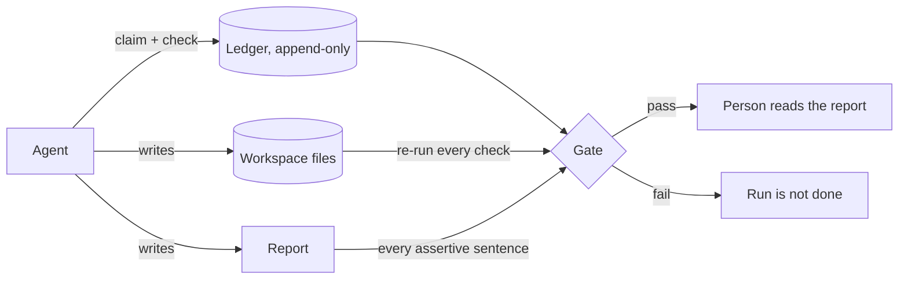

# agent-claim-gate

[](https://github.com/galpetame/agent-claim-gate/actions/workflows/tests.yml)

**Agents say "done". This checks.**

An agent finishes a run and reports: built, verified, 83 pages, tests pass, sent. Part of that is true. This repo is a gate that lets a report state as fact only what a re-runnable check confirms. It contains:

- 8 kinds of check against files in the workspace;
- an append-only claim ledger with a hash chain;
- a report linter for English and Russian: an assertive sentence must cite a verified claim or say that it is an estimate;
- 7 invariants, checked on 300 fuzzed workspaces with one injected fault each;
- a mutation check that plants 23 known bugs in the gate and confirms each one is caught;
- one 400-line module that passes all of it.

It needs only the Python standard library and pytest. There is no model, no API key and no network access.

```bash
pip install pytest
python -m pytest -q                        # 433 tests
python examples/pack/build.py              # an honest build: GATE PASSED
python examples/pack/build.py --overflow   # the pack grew by two pages: GATE FAILED
python tools/mutation_check.py             # 23/23 planted bugs caught
```

## Why this exists

I run projects with several coding agents that share one source-of-truth file. The failures that cost me time were rarely wrong answers. They were reports that had run ahead of the workspace:

- A build of an 83-page pack that had to be printed and signed reported success. Two sections had spilled onto a second page, so the file had two pages too many and every "page N of 83" stamp was wrong.
- A print checklist went back to an old page count after every rebuild, because an outdated source file kept overwriting the corrected copy.
- A contract was filed under a name that said "signed". The file had been re-saved by a script and carried no signature.

Each of these was caught by a one-off check, and late. This repo turns those checks into a gate that runs every time. [docs/case-study.md](docs/case-study.md) describes the first one in detail, and `examples/pack/build.py` reproduces all three faults.

## The rule

The agent never decides what is verified. It records a claim together with a check, and the gate decides.



- **A claim is a ledger record:** an id, a statement, what the agent declares it to be (`verified`, `estimated` or `hypothesis`) and a check.
- **A check points at a file in the workspace.** The gate re-runs it. It executes no commands and writes nothing, because the agent under test wrote the ledger.
- **Evidence has to be newer than its sources.** If a source changed after the output was produced, the claim is stale until someone rebuilds.
- **The ledger is append-only.** Each record carries the hash of the previous one. A correction is a new record with the same id, so the history stays on file.
- **The report may not say more than the ledger.** A sentence with "done", "verified", "passed" or "sent" has to cite a claim that verified, or say plainly that it is an estimate.

A record looks like this:

```json
{"id": "C-1", "text": "the pack has 83 pages", "declared": "verified",
 "check": {"kind": "count", "path": "print/pack.txt", "pattern": "--- page \\d+/\\d+ ---", "equals": 83, "unit": "page"},
 "sources": ["src/pack.md"], "prev": "0000…"}
```

And the report cites it: `The pack is built and verified: 83 pages [C-1].`

## Checks

| Kind | Passes when | Parameters |
|---|---|---|
| `exists` | the file is there | `path` |
| `sha256` | the file has exactly these bytes | `path`, `hex` |
| `contains` | the text occurs at least `min` times | `path`, `text`, `min` (default 1) |
| `absent` | the text does not occur | `path`, `text` |
| `count` | the pattern matches exactly `equals` times | `path`, `pattern`, `equals`, `unit` (optional) |
| `number` | the number captured by the pattern equals `equals`; `128,450.10` and `128 450,10` read the same | `path`, `pattern`, `equals`, `unit` (optional) |
| `json` | the value at the pointer equals `equals` | `path`, `pointer`, `equals` |
| `junit` | a JUnit XML report has at least `min_tests` tests and none failed or errored | `path`, `min_tests` (default 1) |

For anything else, have the agent's tools write a result file (a delivery receipt, an API response, a test report) and check that file.

## Verdicts

| Verdict | Meaning | Gate |
|---|---|---|
| `verified` | the check ran and the evidence agrees | pass |
| `unchecked` | declared an estimate or a hypothesis, with no check | pass; the report must hedge |
| `contradicted` | the check ran and the evidence disagrees | fail |
| `stale` | a source changed after the evidence was produced, or a source is gone | fail |
| `missing` | the evidence file is not there | fail |
| `unbacked` | declared verified, but no check was supplied | fail |
| `rejected` | the check itself is unacceptable: unknown kind, a path outside the workspace, a bad pattern | fail |

## The report linter

It reads the report sentence by sentence and skips code blocks. Three rules:

1. A sentence that asserts completion (done, verified, passed, fixed, sent, deployed; готово, проверено, отправлено, …) must cite a claim: `[C-3]`. A hedge instead of a citation is also accepted: "an estimate", "not verified", "probably".
2. A cited claim must exist. If the sentence is not hedged, the claim must also be `verified`.
3. If the check has a `unit`, a number next to that unit in the sentence must equal the checked value. "82 pages [C-1]" fails when C-1 checked 83.

Negations pass without a citation: "Nothing has been printed or sent." A hedge covers its own clause only: "Not verified by hand, but the upload is done." fails on the second clause.

## Invariants

They are defined in [`invariants.py`](invariants.py) and hold for every workspace, whatever the agent wrote into the ledger.

| ID | Invariant |
|---|---|
| INV-1 | Sound pass: if the gate passes, no claim is contradicted, stale, missing, unbacked or rejected |
| INV-2 | Evidence binds: change or remove the evidence behind a verified claim and the gate fails on that claim |
| INV-3 | History binds: edit, remove, insert or reorder a ledger record and the chain check reports it |
| INV-4 | No free assertions: a report passes only if every assertive sentence cites a verified claim or is hedged |
| INV-5 | Read-only: checking changes no file in the workspace and not the ledger |
| INV-6 | Deterministic: the same workspace gives the same result twice |
| INV-7 | Confined: a check that points outside the workspace is rejected, even if that file would satisfy it |

### Fuzzing

[`tests/test_fuzz.py`](tests/test_fuzz.py) builds 300 random workspaces. Each has two to six true claims of random kinds, a ledger and a report, and must pass. Then one fault is applied, and the gate must fail and name that fault:

- an evidence file is deleted, or changed so that its claim becomes false;
- a source file becomes newer than the evidence built from it;
- a ledger record is edited, dropped or swapped with its neighbour;
- a claim is added with no check, or with a check that points outside the workspace;
- the report gains a bare "done", a citation of a claim that does not exist, or a wrong page count.

INV-1, INV-5 and INV-6 are asserted before and after the fault.

### Mutation check

Tests that pass prove little if they would also pass on a broken gate. [`tools/mutation_check.py`](tools/mutation_check.py) plants 23 bugs in `claim_gate.py` one at a time, for example "stale evidence passes", "check may read outside the workspace" and "report: wrong number passes", and runs the suites against each.

```text
23/23 planted bugs caught
```

## Use it with your own agent

1. Give the agent one tool or one instruction: after each step that produces something, record a claim with `claim_gate.append(ledger, id, text, check=...)`, and cite the id in the report.
2. Run the gate where the agent cannot skip it, in CI or in the orchestrator:

```bash
python claim_gate.py run/ledger.jsonl --root run/workspace --report run/report.md
```

It prints one line per claim and exits non-zero if the run is not done.

3. To catch a cut tail, store the printed head hash outside the workspace and pass it back with `--head`.

```python
from claim_gate import gate

result = gate("run/ledger.jsonl", "run/workspace", report="run/report.md")
if not result.ok:
    hand_to_a_person(result.verdicts, result.problems, result.lint)
```

## Where it fits

| Approach | What it tells you | What it needs |
|---|---|---|
| Model-graded evals | whether an answer reads as correct | a judge model, keys, minutes per suite |
| Your test suite | whether the code works | tests the agent did not write for itself |
| Traces and logs | what the agent did, afterwards | someone to read them |
| **This repo** | whether each thing the report states as fact is true in the workspace right now | Python; no keys |

They complement each other. A JUnit report from your test suite is good evidence for a `junit` claim.

## Limits

- It proves facts about files. "Sent" can be verified only if sending leaves a file to check, such as a receipt.
- The linter matches a fixed list of English and Russian words. A sentence can overclaim in words that are not on the list.
- A hash chain shows edits, removals and reordering. It does not show that the tail was cut unless you keep the head hash elsewhere.
- Staleness uses file times. That catches honest mistakes. Against an agent that forges times, bind sources with `sha256` claims.
- Patterns come from the ledger, which is untrusted. They are limited to 200 characters and evidence files to 5 MB. Run the gate with the same care as any tool that reads untrusted input.

## Related

[voice-agent-acceptance-tests](https://github.com/galpetame/voice-agent-acceptance-tests) applies the same idea to a phone-booking agent: 18 go-live checks and 8 invariants on what the agent did to the schedule.

## License

MIT
